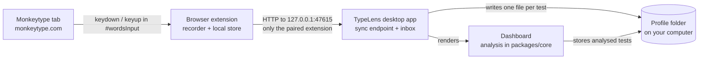

# TypeLens

**Local, private typing analytics for [Monkeytype](https://monkeytype.com).** Monkeytype only keeps aggregate
results, so TypeLens records your keystrokes itself while you take tests: a small browser extension captures the
key-down and key-up timing in Monkeytype's typing box and hands it to a desktop app on your own machine. The app
analyses every test (per-key, bigram, trigram, word, finger and hand statistics, heatmaps, keystroke replay, progress
over time) and builds weak-spot practice text you can paste into Monkeytype's Custom mode. Nothing leaves your
computer, there is no account, and there is no telemetry.

TypeLens is inspired by TypeQuicker's analytics. It is an independent project and is **not affiliated with
Monkeytype or TypeQuicker**.

<!-- TODO: add screenshots (dashboard overview, keyboard heatmap, replay with WPM graph) to docs/screenshots/ and link them here. -->
## Screenshots

_Screenshots are not available yet. TODO: add images under `docs/screenshots/` and embed them in this section._

## Features

**Recording**

- Records `keydown` / `keyup` times and the characters you type, only inside Monkeytype's typing box.
- Stores the test settings and the numbers on the result screen (WPM, accuracy, consistency, duration, mode).
- Passive: it never cancels or changes an event, never edits the page, and never records other fields or other sites.
- Also keeps the things Monkeytype shows once and then discards: the result graph (WPM so far, raw speed and errors
  per second) and the burst speed of every word, rebuilt from the stored keystrokes.

**Analysis**

- Per-key speed, error rate, hold time and count, with a keyboard heatmap and a sortable table.
- Bigrams and trigrams with cost bars, search, and a minimum sample filter.
- Slowest and most-mistyped words.
- Finger and hand statistics, a hand diagram, left-versus-right comparison, same-finger bigrams, hand alternation and
  an inter-key-interval histogram.
- Overview with KPI cards, a WPM and accuracy trend, a 12-month activity heatmap with streaks, and the weakest spots.

**Replay**

- Monkeytype-style text view with correct, incorrect and extra characters and the caret.
- Play, pause, 0.5x / 1x / 2x / 4x speed and a scrubber, with a live keyboard showing the keys held down.
- Per-test WPM graph, rebuilt from your own keystrokes.

**Progress and practice**

- WPM, accuracy, consistency and minutes-per-day charts, improved and regressed n-grams, current and longest streak.
- Practice generator (focus on n-grams, keys or fingers; length, emphasis and hand settings) that produces text to
  paste into Monkeytype's Custom mode. The last 20 generated texts are kept for reuse.

**Data**

- Import Monkeytype's results CSV (Account -> export CSV) for long-term history. These imported tests have speed and
  accuracy only, because Monkeytype never stored keystrokes for them, so they have no replay or key statistics.
- Export all data as JSON, or sessions and keystrokes as CSV; delete a single session; delete all data behind a typed
  confirmation.
- When there are no real tests yet, the dashboard shows clearly labelled demo data.

**Desktop app**

- Windows installer (NSIS `.exe`) and portable `.zip`, and Linux packages (`.deb`, `.rpm`).
- Tests arrive automatically: the extension hands each finished test to the app, and the app stores it on your computer.
- A notification when a new test arrives while the window is in the background (can be turned off in Settings).
- Native menus and shortcuts: Ctrl+1 to Ctrl+9 switch pages, Ctrl+I imports, Ctrl+E exports JSON, plus the usual zoom
  keys. Import and export use the system file dialogs.
- Start at login (optional, in Settings).
- Update checks against GitHub Releases shortly after launch and every six hours. An update is downloaded in the
  background, and installed only when you choose **Restart to update**.
- The sync endpoint listens on `127.0.0.1` only. Only the TypeLens extension may use it, after pairing.

## Install

Download the packages for your system from the
[**Releases** page](https://github.com/HACKERHSB1453/Typelens/releases).

| System | Package | How to install |
| --- | --- | --- |
| Windows 10/11 | `TypeLens-Setup-<version>-x64.exe` (installer) or `TypeLens-<version>-win-x64.zip` | Run the installer. The `.zip` is a portable copy; it does not update itself. |
| Debian 12+ / Ubuntu 22.04+ (amd64) | `TypeLens-<version>-amd64.deb` | `sudo apt install ./TypeLens-<version>-amd64.deb` |
| Fedora / RHEL family (x86_64) | `TypeLens-<version>-x86_64.rpm` | `sudo dnf install ./TypeLens-<version>-x86_64.rpm` |

The names follow the `artifactName` patterns in `apps/desktop/electron-builder.yml`. Use the files listed on the Releases
page for your version. The `.deb` is built for Debian 12+ and Ubuntu 22.04+; the `.rpm` is built and tested on Fedora.
Install with `apt` or `dnf` (not `dpkg -i` or `rpm -i`) so the required libraries are pulled in automatically.

### Install the browser extension

The extension records your tests. It works in Chrome, Edge and Brave (Chrome 110 or newer).

1. Get the extension folder: in TypeLens choose **File -> Open browser-extension folder**, or download
   `TypeLens-extension-<version>.zip` from the same release and extract it to a folder you will keep.
2. Open `chrome://extensions` (Edge: `edge://extensions`, Brave: `brave://extensions`).
3. Turn on **Developer mode**.
4. Click **Load unpacked** and select the extension folder (the one that contains `manifest.json`).

Keep the folder where it is. Chrome reads the extension from it, so moving or deleting it disables the extension.
Updating the desktop app does not update an unpacked extension; repeat the steps with the new extension zip (or
click the reload button on the extension card).

Then open monkeytype.com and finish a test. The extension badge shows how many tests are waiting to reach the app.

## How it works



1. The **recorder** runs only on monkeytype.com, inside Monkeytype's typing box, and collects each test with its
   key timing and result numbers.
2. The **extension** keeps finished tests in its own local database and pushes them to the desktop app on
   `127.0.0.1`. The app writes each test to disk before answering, so a test is only marked delivered once it is safe.
3. The **dashboard** (the app's window) imports the tests from the app's inbox into its own database and computes
   every statistic with the shared analysis code in `packages/core`. Nothing is recomputed from a server.

The detailed design, including storage locations and the message contract, is in
[docs/ARCHITECTURE.md](docs/ARCHITECTURE.md).

## Privacy

TypeLens runs entirely on your computer. There is no account, no telemetry, no analytics and no cloud service.
The extension makes no requests to the internet. The desktop app contacts GitHub Releases only to check for updates.
The full list of what is recorded, where it is stored and what (if anything) leaves your machine is in
[PRIVACY.md](PRIVACY.md).

## Build from source

Requirements: Node.js 22 and npm. The repository is an npm workspace.

```bash
npm ci                         # install all workspaces
npm test                       # unit tests (core, extension, web <-> extension sync)
npm run typecheck              # strict TypeScript across the workspaces
npm run build                  # build the extension and the dashboard
npm run start:desktop          # run the desktop app from source (development)
npm run dev:desktop            # desktop app with the dashboard's Vite dev server (hot reload)
npm run dist:win               # Windows installer and .zip -> apps/desktop/release
npm run dist:linux             # .deb and .rpm -> apps/desktop/release
```

Linux packages can also be built on Windows (or any machine with Docker) using the official Electron builder image:

```powershell
docker run --rm -ti -v "${PWD}:/project" -w /project electronuserland/builder /bin/bash -c "npm ci && npm run dist:linux"
```

Run it from a clean checkout or delete `node_modules` first, because installed native modules are platform specific.

macOS is not shipped in the releases. macOS users can try building from source (`npm run start:desktop`), but this
is untested.

## Project structure

```
apps/desktop/        Electron desktop app: window, sync endpoint on 127.0.0.1, inbox, auto-update
apps/extension/      Chrome MV3 extension: recorder on monkeytype.com, local store, popup, bridge
apps/web/            React + Vite dashboard (the screens shown in the desktop app)
packages/core/       analysis engine (pure TypeScript) and the data contract (src/schema.ts)
docs/                architecture, releasing, and the original Aviary specs (docs/aviary/)
.github/             CI, release workflow, issue and pull request templates
```

## Contributing

Bug reports, feature ideas and pull requests are welcome. Please read [CONTRIBUTING.md](CONTRIBUTING.md) first.
Security issues must be reported privately, as described in [SECURITY.md](SECURITY.md). This project follows the
[Code of Conduct](CODE_OF_CONDUCT.md).

## License

TypeLens is released under the [MIT License](LICENSE).

## Acknowledgements and disclaimer

- TypeLens is an independent project and is **not affiliated with, endorsed by or sponsored by Monkeytype or
  TypeQuicker**. Monkeytype and TypeQuicker are trademarks of their respective owners.
- Monkeytype is licensed under the GPL. TypeLens does not copy Monkeytype's code: it reimplements the published
  formulas (for example WPM and accuracy) in its own code. The practice word list was compiled for this project.
- The dashboard uses the Hack font, React, Chart.js, Electron and other open-source components; see each package's
  dependencies for their licenses.
- The analysis is an estimate built from the keystrokes your browser reports. Timing depends on your keyboard, OS and
  browser, so treat the numbers as a guide, not an official score.
