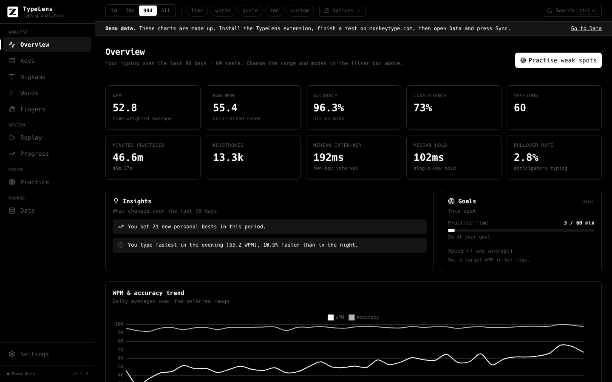
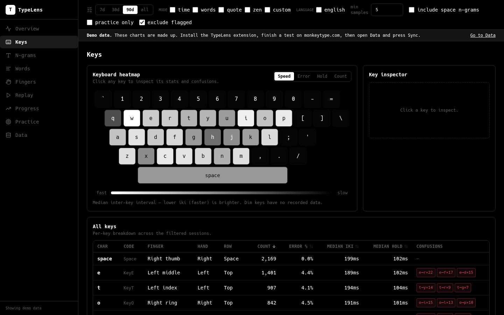
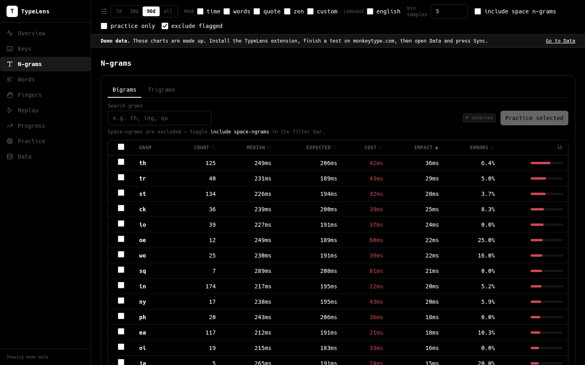
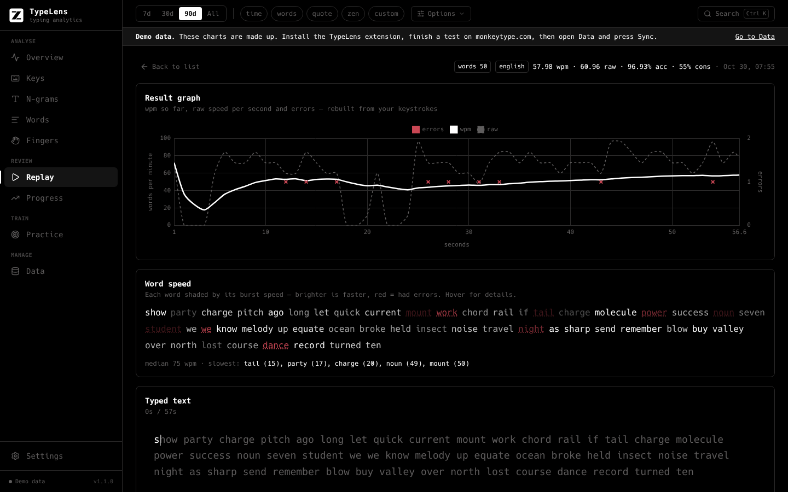
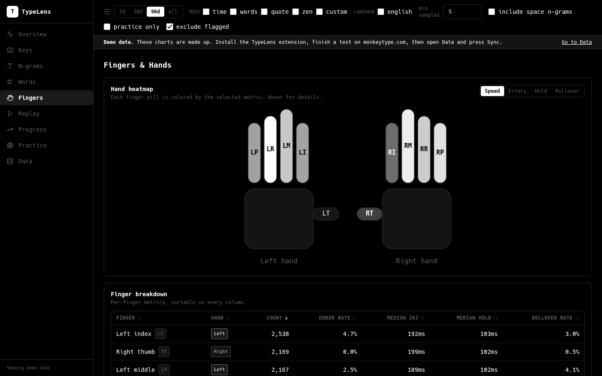
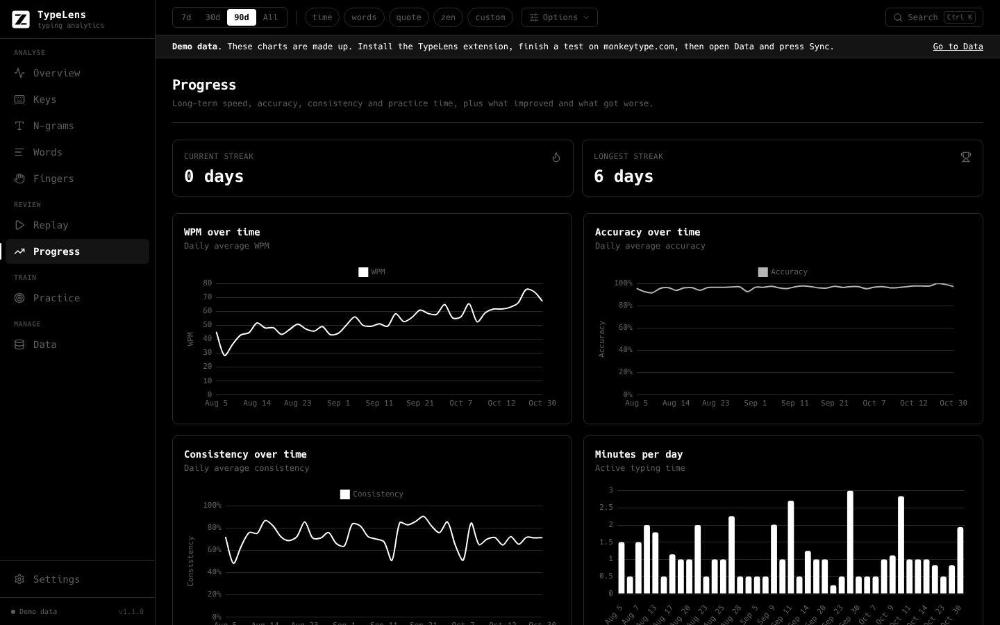
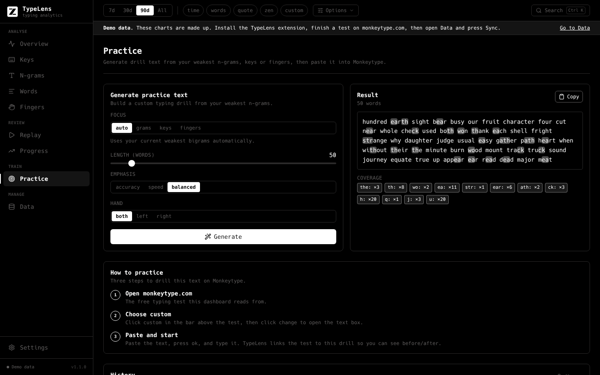
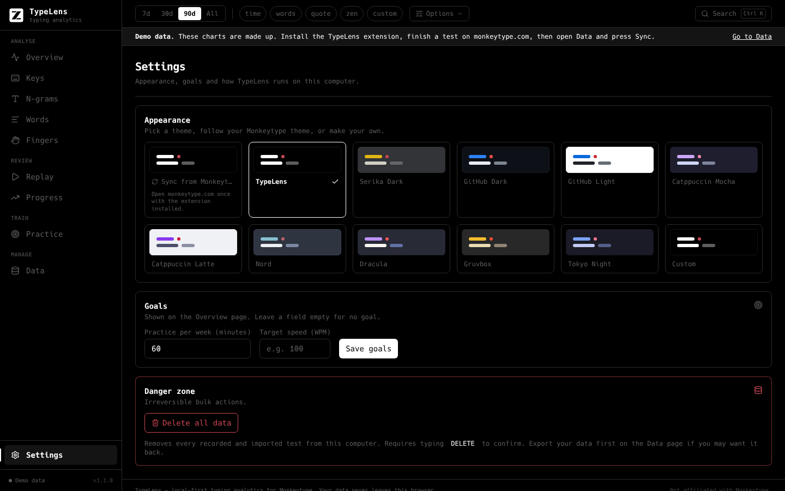
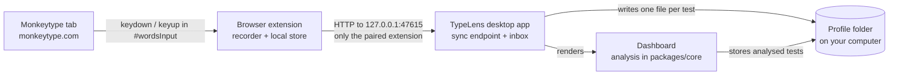

<div align="center">


# TypeLens

**Local, private typing analytics for [Monkeytype](https://monkeytype.com).**

See exactly which keys, letter pairs, words and fingers slow you down, replay every test keystroke by keystroke,
and generate practice text that targets your weak spots. Everything stays on your computer.

[](https://github.com/HACKERHSB1453/Typelens/releases/latest)
[](https://github.com/HACKERHSB1453/Typelens/releases)
[](LICENSE)


[**Download**](https://github.com/HACKERHSB1453/Typelens/releases/latest) ·
[Getting started](#getting-started) ·
[Updating](#updating) ·
[Using TypeLens](#using-typelens) ·
[Privacy](#privacy) ·
[Build from source](#build-from-source)

<br>



</div>

---

## Why TypeLens?

Monkeytype tells you your WPM and accuracy, but it only keeps the totals. It doesn't tell you *why* you are slow.

TypeLens records the timing of every key you press and release while you take a test, then analyses it on your own
machine. You get per-key speed and error rates, the bigrams and trigrams that cost you the most time, finger and hand
balance, word-level burst speed and a full replay of each test. It then turns your weak spots into practice text you
can paste straight into Monkeytype.

- **Private by design.** No account, no telemetry, no cloud. Your data never leaves your computer.
- **Zero effort.** Type on Monkeytype as usual. Tests appear in the app automatically.
- **Actionable.** Every chart points at something you can practise, and the practice generator does it for you.

> TypeLens is an independent project and is **not affiliated with Monkeytype or TypeQuicker**.

## Screenshots

<table>
  <tr>
    <td width="50%"><br><b>Keys.</b> Keyboard heatmap by speed, errors, hold time or count, with a per-key table and common mistypes.</td>
    <td width="50%"><br><b>N-grams.</b> Bigrams and trigrams ranked by how much time they cost you. Select some and practise them directly.</td>
  </tr>
  <tr>
    <td width="50%"><br><b>Replay.</b> The result graph Monkeytype throws away, word burst speeds, and a keystroke-by-keystroke replay.</td>
    <td width="50%"><br><b>Fingers &amp; hands.</b> Per-finger speed, errors, hold time and rollover, plus left-versus-right balance.</td>
  </tr>
  <tr>
    <td width="50%"><br><b>Progress.</b> WPM, accuracy, consistency and practice time over time, with streaks.</td>
    <td width="50%"><br><b>Practice.</b> Generate a drill from your weakest n-grams, keys or fingers and paste it into Monkeytype.</td>
  </tr>
</table>

<sub>Screenshots show the built-in demo data, which the app displays until your first real test arrives.</sub>

## Getting started

Setup takes about two minutes: install the desktop app, load the browser extension, and take a test.

> **Don't want to install an app?** The extension has the whole dashboard built in. Skip step 1, load the extension
> (step 2), then see [Using TypeLens without the desktop app](#using-typelens-without-the-desktop-app).

### 1. Install the desktop app

Download the package for your system from the
[**latest release**](https://github.com/HACKERHSB1453/Typelens/releases/latest).

| System | File | Install |
| --- | --- | --- |
| **Windows 10 / 11** | `TypeLens-Setup-<version>-x64.exe` | Run the installer. A portable `TypeLens-<version>-win-x64.zip` is also available (it does not auto-update). |
| **macOS (Apple Silicon)** | `TypeLens-<version>-mac-arm64.dmg` | Open the `.dmg` and drag TypeLens to Applications. See the first-launch note below. |
| **macOS (Intel)** | `TypeLens-<version>-mac-x64.dmg` | Same as above. |
| **Ubuntu 22.04+ / Debian 12+** | `TypeLens-<version>-amd64.deb` | `sudo apt install ./TypeLens-<version>-amd64.deb` |
| **Fedora / RHEL family** | `TypeLens-<version>-x86_64.rpm` | `sudo dnf install ./TypeLens-<version>-x86_64.rpm` |
| **Arch Linux / Manjaro / EndeavourOS** | `TypeLens-<version>-x64.pacman` | `sudo pacman -U ./TypeLens-<version>-x64.pacman` |

Install with `apt`, `dnf` or `pacman` so the required libraries are pulled in automatically. Arch users can also use
the AUR recipe in [`packaging/aur`](packaging/aur/README.md) (`typelens-bin`).

> **macOS first launch:** the app is not notarized by Apple yet, so macOS says it *"cannot be opened because the
> developer cannot be verified"*. Right-click (or Control-click) TypeLens in Applications, choose **Open**, then
> **Open** again. You only need to do this once. On macOS 15+, if there is no Open button, go to
> **System Settings → Privacy & Security** and click **Open Anyway**. Automatic updates are not available on macOS yet:
> download new versions from the releases page.

> **Windows SmartScreen:** the installer is not code-signed yet, so Windows may show *"Windows protected your PC"*.
> Click **More info → Run anyway**.

### 2. Load the browser extension

The extension is what records your tests. It works in **Chrome, Edge, Brave, Opera and Vivaldi** (version 110 or
newer) and in **Firefox** (version 128 or newer, see [Firefox](#firefox) below).

1. Open `chrome://extensions` (Edge: `edge://extensions`, Brave: `brave://extensions`).
2. Turn on **Developer mode** (top-right toggle).
3. Click **Load unpacked** and select the extension folder that comes with the app:

   | System | Extension folder |
   | --- | --- |
   | Windows | `%LOCALAPPDATA%\Programs\TypeLens\resources\extension` (default install location) |
   | macOS | `/Applications/TypeLens.app/Contents/Resources/extension` (in the folder picker, press `Cmd+Shift+G` and paste the path) |
   | Linux | `/opt/TypeLens/resources/extension` |

   In TypeLens, **File → Open browser-extension folder** opens it for you.

**Use the app's folder.** When TypeLens updates, it replaces this folder with the matching new extension, so the
extension stays up to date with the app (see [Updating](#updating)). You can also download
`TypeLens-extension-<version>.zip` from the release and extract it somewhere permanent, but then you have to update it
by hand. Either way, don't move or delete the folder: the browser loads the extension from it.

#### Firefox

Firefox uses its own build of the extension, in the `extension-firefox` folder next to the one above, and in
`TypeLens-extension-firefox-<version>.zip` on the release page.

- **Permanent install:** when the release has a signed `TypeLens-extension-firefox-<version>.xpi`, open it in Firefox
  (or drag it onto a Firefox window) and click **Add**.
- **Quick try:** open `about:debugging#/runtime/this-firefox`, click **Load Temporary Add-on…** and pick
  `manifest.json` in the `extension-firefox` folder. Firefox removes temporary add-ons when it closes.

If the popup says TypeLens needs access, click **Allow access**: Firefox can install extensions without their site
permissions, and TypeLens needs monkeytype.com (to record) and 127.0.0.1 (to reach the desktop app).

### 3. Take a test

1. Start the TypeLens desktop app and leave it running (it can sit in the background).
2. Go to [monkeytype.com](https://monkeytype.com) and finish a test.
3. The test shows up in TypeLens within a few seconds, and the demo data disappears.

The first extension that connects is paired with the app automatically. The extension's toolbar badge shows how many
tests are still waiting to be delivered, for example while the app is closed. Nothing is lost: they are sent the next
time the app runs.

## Using TypeLens without the desktop app

The desktop app is optional. The extension contains the complete dashboard, every page included, so you can use
TypeLens on a computer where you can't or don't want to install software (a school or work computer, a Chromebook, or
just to try it out).

1. Load the extension as in [step 2](#2-load-the-browser-extension) (from the extracted
   `TypeLens-extension-<version>.zip`, or the Firefox build).
2. Finish a test on monkeytype.com.
3. Click the TypeLens toolbar button, then **Open dashboard**.

New tests appear in the open dashboard as soon as you finish them, with no sync step. Your tests are stored in the
browser's extension storage, so they stay on this computer and survive browser restarts, but they are deleted if you
remove the extension. Use **Data → Export JSON** for a backup, and **Import** to bring it back or to move it to the
desktop app.

What only the desktop app does: automatic updates, start at login, notifications and keeping your data in plain files.
If you run both, the extension keeps delivering every test to the app as well, so you can switch at any time.

## Updating

**The app.** On Windows and Linux, TypeLens checks for new versions shortly after it starts and every six hours. An
update downloads in the background and installs when you click **Restart to update** (Linux asks for your password,
because the package manager installs it). You can also check by hand in **Settings**. On macOS, and for the portable
Windows `.zip`, download the new version from the [releases page](https://github.com/HACKERHSB1453/Typelens/releases).

**The extension.** If you loaded it from the app's folder, an app update already put the new extension there. The
browser picks it up the next time it restarts, or right away when you click the reload button (↻) on the TypeLens card
in `chrome://extensions`. If you loaded it from an extracted zip, download the new
`TypeLens-extension-<version>.zip`, replace the folder's contents and click reload.

The changes in each version are listed in the [changelog](CHANGELOG.md).

## Using TypeLens

The sidebar has one page per kind of analysis. The filter bar at the top applies to every page: pick a time range
(7d / 30d / 90d / all), Monkeytype modes, language, a minimum sample size, and whether to include practice tests.

| Page | What it answers |
| --- | --- |
| **Overview** | How am I doing overall? WPM, accuracy, consistency, a trend chart, a 12-month activity heatmap and your weakest spots. |
| **Keys** | Which keys are slow or error-prone? Click a key on the heatmap to inspect it and see what you mistype it as. |
| **N-grams** | Which letter pairs and triples cost the most time? Sort by impact to find the biggest wins. |
| **Words** | Which words are slowest or most often mistyped? |
| **Fingers** | Which fingers and which hand hold you back? Includes same-finger bigrams and hand alternation. |
| **Replay** | What actually happened in a specific test? Watch it back at 0.5×–4× with a live keyboard. |
| **Progress** | Am I improving? Long-term charts, improved and regressed n-grams, and streaks. |
| **Practice** | What should I practise? Generates targeted text from your weak spots. |
| **Data** | Import, export, extension status and pairing, and deleting single tests. |

### A practice loop that works

1. Take 5–10 normal tests on Monkeytype so TypeLens has enough data.
2. Open **N-grams**, sort by **Impact**, tick the worst few and click **Practice selected**. Or open **Practice** and
   leave the focus on **auto**.
3. Click **Generate**, then copy the text.
4. On Monkeytype, choose **custom → change**, paste the text and type it.
5. TypeLens links that test to the drill, so you can compare before and after.

### Import your Monkeytype history

On Monkeytype, go to **Account → export CSV**. Then in TypeLens open **Data → Import JSON / Monkeytype CSV** (or press
`Ctrl+I`). Imported tests add to your long-term WPM and accuracy history. They have no replay or key statistics,
because Monkeytype never stored keystrokes for them.

### Keyboard shortcuts

| Shortcut | Action |
| --- | --- |
| `Ctrl+1` … `Ctrl+9` | Switch pages |
| `Ctrl+I` | Import |
| `Ctrl+E` | Export everything as JSON |
| `Ctrl+,` | Settings |
| `Ctrl+=` / `Ctrl+-` / `Ctrl+0` | Zoom in / out / reset |

### Settings and themes

Open **Settings** from the bottom of the sidebar (or press `Ctrl+,`, `Cmd+,` on macOS).



- **Themes.** Pick one of the built-in themes: TypeLens, Serika Dark, GitHub Dark and Light, Catppuccin Mocha and
  Latte, Nord, Dracula, Gruvbox and Tokyo Night.
- **Sync from Monkeytype.** TypeLens uses the theme you have on monkeytype.com, including custom themes, and follows
  it when you change it there. The extension reads the colours while you are on Monkeytype.
- **Custom.** Set your own six colours (background, panels, secondary text, text, accent and error), the same way
  Monkeytype's custom themes work. You can start from any built-in theme or from your Monkeytype theme.
- **Start at login.** Launches TypeLens in the background so tests always arrive.
- **Notifications.** Shows a notification when a new test arrives while the window is in the background.
- **Updates.** TypeLens checks GitHub Releases shortly after launch and every six hours. Updates download in the
  background and install only when you click **Restart to update**.
- **Delete all data.** In the Danger zone, behind a typed `DELETE` confirmation.

## Troubleshooting

<details>
<summary><b>Tests don't show up in the app</b></summary>

- Make sure the desktop app is running. The extension holds tests until it can deliver them, and the badge shows the count.
- Click the TypeLens toolbar button and press **Sync now**. The popup shows whether it reached the app.
- Check that the extension is enabled (`chrome://extensions`, or `about:addons` in Firefox) and that its folder still
  exists.
- In Firefox, if the popup shows **Allow access**, click it.
- If you reinstalled the extension, its id changed and the app still trusts the old one. Click **Reset pairing** in
  the Extension panel on the **Data** page, then reload monkeytype.com.

</details>

<details>
<summary><b>Fedora: "file /usr/lib/.build-id/... conflicts with file from package ..."</b></summary>

This only affects TypeLens 1.0.0, which clashed with other Electron apps (Slack, VS Code and others). Version 1.0.1
and later install normally. To install 1.0.0 anyway, leave out the conflicting debug links:

```bash
sudo rpm -i --excludepath=/usr/lib/.build-id TypeLens-<version>-x86_64.rpm
```

</details>

<details>
<summary><b>macOS says TypeLens "is damaged" or "cannot be opened"</b></summary>

The app isn't notarized by Apple yet. Right-click TypeLens in Applications and choose **Open**, or use **System
Settings → Privacy & Security → Open Anyway**. If macOS still says it is damaged, clear the download quarantine flag:

```bash
xattr -dr com.apple.quarantine /Applications/TypeLens.app
```

</details>

<details>
<summary><b>Windows says "Windows protected your PC"</b></summary>

The installer isn't code-signed yet. Click **More info → Run anyway**.

</details>

<details>
<summary><b>I updated TypeLens but the extension is still old</b></summary>

The browser only reads the extension's files when it starts or when you reload the extension. Click the reload button
(↻) on the TypeLens card in `chrome://extensions`. If it is still old, check which folder it was loaded from (shown on
the card): if it's not the app's folder, see [Load the browser extension](#2-load-the-browser-extension) and load it
from there instead.

</details>

## How it works



1. The **recorder** runs only on monkeytype.com, inside Monkeytype's typing box. It is passive: it never changes an
   event or edits the page, and it never records other fields or other sites.
2. The **extension** stores finished tests locally and pushes them to the desktop app on `127.0.0.1`. The app writes
   each test to disk before replying, so a test is only marked delivered once it is safe.
3. The **dashboard** computes every statistic locally with the shared analysis engine in `packages/core`.

The full design, including storage locations and the message contract, is in [docs/ARCHITECTURE.md](docs/ARCHITECTURE.md).

## Privacy

TypeLens runs entirely on your computer. There is **no account, no telemetry, no analytics and no cloud service**.
The extension makes no requests to the internet. The desktop app contacts GitHub only to check for updates, and its
sync endpoint listens on `127.0.0.1` only. What is recorded, where it is stored and what (if anything) leaves your
machine is listed in [PRIVACY.md](PRIVACY.md).

You can export all of your data as JSON or CSV from the **Data** page, and delete it at any time from **Settings**.

## Build from source

Requirements: **Node.js 22** and npm. The repository is an npm workspace.

```bash
npm ci                    # install all workspaces
npm test                  # unit tests
npm run typecheck         # strict TypeScript across the workspaces
npm run start:desktop     # run the desktop app from source
npm run dev:desktop       # desktop app with hot reload
npm run build -w @typelens/extension   # extension -> apps/extension/dist (Chromium), dist-firefox (Firefox)
npm run dist:linux        # .deb, .rpm and .pacman -> apps/desktop/release (needs rpm and bsdtar)
npm run dist:win          # .exe and .zip   -> apps/desktop/release
npm run dist:mac          # .dmg (on a Mac) -> apps/desktop/release
```

Linux packages can also be built anywhere Docker runs, using the official Electron builder image:

```bash
docker run --rm -ti -v "${PWD}:/project" -w /project electronuserland/builder /bin/bash -c "npm ci && npm run dist:linux"
```


### Project structure

```
apps/desktop/      Electron app: window, local sync endpoint, inbox, auto-update
apps/extension/    Chrome MV3 extension: recorder on monkeytype.com, local store, popup
apps/web/          React + Vite dashboard (the screens shown in the desktop app)
packages/core/     analysis engine (pure TypeScript) and the data contract
docs/              architecture, release process and screenshots
.github/           CI, release workflow, issue and pull request templates
```

## Contributing

Bug reports, feature ideas and pull requests are welcome. Please read [CONTRIBUTING.md](CONTRIBUTING.md) first.
Report security issues privately as described in [SECURITY.md](SECURITY.md). This project follows the
[Code of Conduct](CODE_OF_CONDUCT.md).

## License and acknowledgements

Copyright (C) 2026 TypeLens contributors.

TypeLens is free software: you can redistribute it and/or modify it under the terms of the
[GNU General Public License](LICENSE) as published by the Free Software Foundation, either version 3 of the License,
or (at your option) any later version. It is distributed in the hope that it will be useful, but WITHOUT ANY WARRANTY;
without even the implied warranty of MERCHANTABILITY or FITNESS FOR A PARTICULAR PURPOSE.

In short: you may use, study, share and change TypeLens. If you distribute it, or a modified version, you must do so
under the same license and make the complete source code available. Versions up to and including 1.0.2 were
released under the MIT License.

- TypeLens is **not affiliated with, endorsed by or sponsored by Monkeytype or TypeQuicker**. Monkeytype and
  TypeQuicker are trademarks of their respective owners. TypeLens is inspired by TypeQuicker's analytics.
- Monkeytype is licensed under the GPL. TypeLens does not copy Monkeytype's code. It reimplements the published
  formulas (for example WPM and accuracy). The practice word list was compiled for this project.
- Built with Electron, React, Chart.js and the Hack font. See each package's dependencies for their licenses.
- The analysis is an estimate built from the keystrokes your browser reports. Timing depends on your keyboard, OS and
  browser, so treat the numbers as a guide, not an official score.
