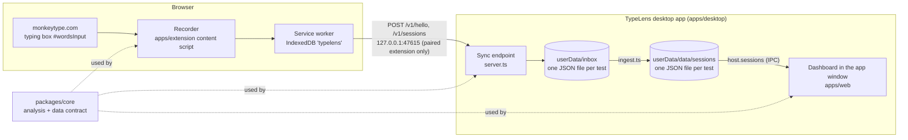

# Architecture

This document describes how TypeLens is built: the packages and their dependencies, how a test travels from
Monkeytype to the dashboard, where data is stored, and how releases are produced. It describes the code as it is in
the 1.0.0 release.

## Overview



## Packages and dependency direction

```
packages/core          pure TypeScript: data contract, analysis, import/export, desktop protocol
packages/host-contract types only: the TypeLensHost interface the dashboard uses to reach its host
   ^   ^   ^   ^
   |   |   |   +------ apps/desktop    (Electron: window, sync endpoint, inbox, store, updates)
   |   |   +---------- apps/web        (dashboard: React + Vite; also runs in a plain browser)
   |   +-------------- apps/extension  (Chrome MV3: recorder, local store, popup, page bridge)
   +------------------ (every package above depends on packages/core)
```

Rules that follow from this:

- `packages/core` depends on nothing in the repository and contains no browser, Electron or DOM code, so it runs in
  plain Node tests.
- Apps depend on the packages, never on each other. The dashboard does not import the extension, and the extension
  does not import the dashboard. Both share the push protocol through `packages/core/src/desktop.ts`.
- The dashboard reaches its host only through `TypeLensHost`, never directly through Electron or `chrome.*`.

### packages/core

| File | Responsibility |
| --- | --- |
| `schema.ts` | The data contract: `Session`, key and input events, `SessionConfig`, analysis result types. `SCHEMA_VERSION` = 1. |
| `derive.ts` | Derives per-keystroke data (hold, flight, finger, hand, row, corrected) from raw events. |
| `analyze.ts`, `ngrams.ts`, `progress.ts`, `replay.ts` | Statistics, n-grams, progress series, replay state. |
| `practice.ts` | Generates weak-spot practice text. |
| `monkeytype.ts` | Monkeytype's published WPM, raw WPM, accuracy and consistency formulas, reimplemented. |
| `export.ts` | JSON and CSV export, and `validateSession`, which is used for imports, the desktop push and the inbox. |
| `history.ts` | Parser for Monkeytype's results CSV (speed and accuracy only). |
| `desktop.ts` | The extension-to-desktop protocol: host, port, paths, batch size and message types. |
| `layout.ts`, `stats-util.ts`, `fixtures.ts` | Keyboard layout model, statistics helpers, test fixtures. |

### apps/extension

- `background.ts`: the MV3 service worker. Owns the IndexedDB store, routes messages, pushes to the desktop app on a
  one-minute alarm and after each new test, and attaches the recorder to Monkeytype tabs that were open at install.
- `handlers.ts`: message handling, written as a pure function over injected dependencies. Each message type is allowed
  only from its own sender (Monkeytype tabs, bridge origins or extension pages).
- `db.ts`: IndexedDB database `typelens` (version 2), one store `sessions` with indexes `startedAt`, `synced` and
  `desktop`.
- `desktop.ts`: the push to the desktop app (hello, then batches of sessions).
- `content/capture-entry.ts`, `content/capture.ts`, `recorder.ts`, `selectors.ts`: the recorder on monkeytype.com.
  `selectors.ts` holds every Monkeytype DOM selector and the health check.
- `content/bridge.ts`, `protocol.ts`, `bridge-origins.ts`: the page bridge for the browser version of the dashboard. It
  answers only four actions (`ping`, `list`, `get`, `ack`) and only for the origins in `bridge-origins.ts`.
- `popup/popup.ts`, `static/popup.html`: the toolbar popup (recording switch, counts, desktop status, Sync now, open the
  app, export JSON).
- `build.mjs`: generates `manifest.json` from `package.json` and the shared constants, so the manifest cannot disagree
  with the runtime checks.

The `desktop` field of the extension's stored sessions records delivery to the desktop app:

| `desktop` | Meaning |
| --- | --- |
| `0` | pending: not yet delivered (the push picks these up, oldest first) |
| `1` | stored by the desktop app (also marked `synced`, which clears the badge) |
| `2` | rejected by the desktop app for a validation reason; never sent again (the reason is kept in `desktopError`) |

### apps/web (dashboard)

- `host/`: `current.ts` returns the host (`window.typelensHost` in the desktop app, otherwise `createWebHost()`).
  `webHost.ts` is the browser implementation. `hooks.ts` holds React hooks for extension status, update state and menu
  navigation.
- `data/index.ts`: chooses between the user's sessions and generated demo sessions (`auto`, `demo` or `mine`), and is
  the only data entry point the screens use.
- `data/LocalDataSource.ts`: the real data source, built on `@typelens/core` and the host's `sessions`, `prefs` and
  `extension` APIs.
- `data/store.ts`: the browser-only IndexedDB store (database `typelens-web`). The desktop app does not use it.
- `pages/`: Overview, Keys, Ngrams, Words, Fingers, Replay, Progress, Practice, Data, NotFound.
- `components/host/`: the Extension panel (status, reset pairing) and the Settings panel (start at login, notifications,
  updates, open data folder), both on the Data page. The update banner is in the app layout.

### apps/desktop

| Module | Responsibility |
| --- | --- |
| `main.ts` | App lifecycle, single-instance lock, windows, IPC handlers, notifications, logging, ingest and update start-up. |
| `preload.ts` | Sandboxed preload. Builds the `TypeLensHost` out of IPC calls and exposes it as `window.typelensHost`. |
| `channels.ts` | IPC channel names, shared by main and preload. |
| `ipc.ts` | Argument validation for every IPC call, and the trusted-sender check. Pure functions, unit-tested. |
| `appProtocol.ts` | Serves the built dashboard from `app://typelens/` with a Content Security Policy. |
| `server.ts` | The sync endpoint on `127.0.0.1:47615`. |
| `inbox.ts` | Durable queue of accepted tests (`userData/inbox`). |
| `ingest.ts` | Moves inbox tests into the session store, then removes them from the inbox. |
| `sessionStore.ts` | The permanent store: one JSON file per session (`userData/data/sessions`). |
| `prefs.ts` | Dashboard preferences (`userData/data/prefs.json`). |
| `settings.ts` | App settings (`userData/settings.json`): window, paired extension, start at login, notifications. |
| `updater.ts` | Wraps electron-updater: checks, background download, restart on the user's request. |
| `menu.ts` | The application menu and its shortcuts. |
| `loginItem.ts` | Start at login: Electron login items on Windows and macOS, an XDG autostart entry on Linux. |
| `windowState.ts`, `fsutil.ts` | Keeps the window on a visible display; atomic file writes. |

`build.mjs` bundles `main.ts` and `preload.ts` with esbuild into `app/`, and builds the dashboard into `app/renderer/`.
The GitHub owner and repository are read from `electron-builder.yml` (`publish`), which is the one place to change
them.

## Host bridge contract

The dashboard does not know whether it runs in the desktop app or in a browser. It uses one interface,
`TypeLensHost`, from `packages/host-contract/src/index.ts`:

| Member | Purpose |
| --- | --- |
| `kind`, `capabilities` | `'desktop'` or `'web'`, and flags such as `nativeFiles`, `notifications`, `autoUpdate`, `extensionPush`, `openFolders`, `startAtLogin`. |
| `app.info()` | Name, version, platform and data folder. |
| `sessions` | `list`, `putMany`, `delete`, `clear`, `count`, `onChange`. |
| `prefs` | `get`, `set` (`null` removes a key). |
| `extension` | `status`, `listPending`, `pullPending`, `ack`, `resetPairing`, `onChange`. |
| `files` | `openImportFile`, `saveExport` (native dialogs on desktop). |
| `shell` | `openExternal` (https only), `openDataFolder`, `openExtensionFolder`, `revealLogs`. |
| `updates` | `state`, `check`, `installAndRestart`, `onChange`. |
| `settings` | `get/setStartAtLogin`, `get/setNotifyOnNewTest`. |
| `onNavigate`, `onMenuAction` | Menu-driven page switches and import/export actions. |

Implementations:

- **Desktop:** `preload.ts` exposes the object through `contextBridge`. Each call is an `ipcRenderer.invoke` on a channel
  from `channels.ts`. `main.ts` accepts a call only when it comes from the top frame of the app's own page
  (`app://typelens`, or the Vite dev server in development). Anything else is refused with `forbidden`.
- **Browser:** `webHost.ts` builds the same surface from IndexedDB (`typelens-web`), `localStorage`, `<input type=file>`
  and downloads, and the extension page bridge. Most capability flags are `false`.

## Extension to desktop push protocol

The contract lives in `packages/core/src/desktop.ts`. The endpoint is `http://127.0.0.1:47615` (`DESKTOP_ORIGIN`).
`DESKTOP_API` = 1 changes only for incompatible changes.

| Path | Body | Reply | Purpose |
| --- | --- | --- | --- |
| `POST /v1/hello` | `DesktopHello`: extension version, last recorder time, health | `{ app: "typelens", api, version }` | Shows "connected" in the app. The first caller is paired. |
| `POST /v1/sessions` | `{ "sessions": [...] }`, at most 20 per request (`DESKTOP_PUSH_BATCH`) | `{ accepted: [ids], rejected: [{ id, error }] }` | Delivers recorded tests. |

Rules enforced by `apps/desktop/src/server.ts`:

1. The server listens on `127.0.0.1` only.
2. The `Host` header must be `127.0.0.1:47615` or `localhost:47615` (otherwise `421`).
3. The `Origin` header must be `chrome-extension://<id>` or `moz-extension://<id>` (otherwise `403`).
4. The first successful caller is paired. A later caller with another id gets `403` until pairing is reset in the app
   (Data page, Extension panel).
5. Only `POST` is accepted (`405`), unknown paths get `404`, the body must be `application/json` (`415`), must be valid
   JSON (`400`) and may be at most `DESKTOP_MAX_BODY` (32 MiB, `413`).
6. Each session must pass `validateSession` and have `source: "monkeytype"`. Failures are listed in `rejected`, and the
   rest of the batch is still stored.
7. Accepted tests are written to the inbox **before** the reply. The extension marks a test delivered only when its id is
   in `accepted`, so a closed app never loses a test.
8. No CORS headers are sent, and every response is `Cache-Control: no-store`.

## Data flow and durability

1. **Record.** The recorder collects one `Session` per test. The service worker stores it in IndexedDB `typelens`
   (`desktop = 0`) before anything else happens.
2. **Deliver.** The service worker pushes pending tests in batches of 20 after each new test, on every start-up and
   install, and on a one-minute alarm. Each accepted id becomes `desktop = 1`; each rejected id becomes `desktop = 2`.
3. **Inbox.** The sync endpoint writes one file per accepted test to `userData/inbox/`. The file name is the hex
   encoding of the id, so an id cannot name a path outside the folder. Writes go to a temporary name and are renamed,
   so a reader sees the old or the complete new file.
4. **Store.** `ingest.ts` runs after each push and once at start-up. It validates each inbox test again, writes it to
   `userData/data/sessions/` (duplicates are skipped by id), and removes it from the inbox only after the store has it.
   The app then sends a change event, and the dashboard reloads.
5. **Analyse.** The dashboard reads sessions through `host.sessions` and computes every statistic with `packages/core`.
   Demo data and real data go through the same code.

Tests imported from a file (JSON export or Monkeytype CSV) go straight to the store through `sessions.putMany`.

## Storage locations

The desktop profile folder is Electron's `userData` for product name `TypeLens`:

| Item | Windows | Linux | Notes |
| --- | --- | --- | --- |
| Profile folder | `%APPDATA%\TypeLens` | `~/.config/TypeLens` | macOS is not built or tested. |
| Sessions (analysed tests) | `data/sessions/<hex-id>.json` | same | One file per test. Long ids are hashed into the name. |
| Preferences | `data/prefs.json` | same | Data source choice and practice history (last 20 generated texts). |
| Inbox (received, not yet stored) | `inbox/<hex-id>.json` | same | Normally empty between pushes. |
| Settings | `settings.json` | same | Window bounds, paired extension id, start at login, notify on new test. |
| Logs | `logs/main.log` | same | Rotated to `main.log.old` at about 1 MB. Contains no keystroke content. |
| Extension database | `typelens` in the browser's extension storage | same | Tests waiting for delivery, and their delivery state. |
| Browser-only dashboard | `typelens-web` IndexedDB and `localStorage` in the browser | same | Only when the dashboard runs in a browser, not in the desktop app. |

## Updates

`updater.ts` uses electron-updater with the GitHub provider:

- Only in a packaged app that has an update feed (`app-update.yml`), and not on macOS. Otherwise the state is
  `unsupported` with a reason. The portable `.zip` is not updated in place.
- The first check runs 20 seconds after launch, then every 6 hours. The application menu can check at any time.
- Updates download in the background, but nothing is installed without the user's action. `autoInstallOnAppQuit` is off.
  When a download is ready, the dashboard shows "Restart to update".
- If the feed is not configured (`OWNER_PLACEHOLDER` still in `electron-builder.yml`, as in a fork that has not set it), updates are reported as
  unavailable.

## Security boundaries

- The sync endpoint's checks are listed above. The threat model and its limits are in [SECURITY.md](../SECURITY.md).
- The dashboard runs in a sandboxed renderer with context isolation, no Node integration and no webview. Its CSP allows
  only its own origin. Permission requests are denied, navigation away from the app is blocked, and `https` links open in
  the user's browser.
- The extension requests `storage`, `unlimitedStorage`, `scripting` and `alarms`. Its only host permission is
  `http://127.0.0.1:47615/*`. It makes no requests to the internet.

## Development

- `npm run dev:desktop` starts the Vite dashboard on `http://localhost:5173` and opens Electron against it
  (`apps/desktop/scripts/dev.mjs` sets `TYPELENS_RENDERER_URL`).
- `npm run dev -w @typelens/web` runs the dashboard alone, in a browser. The extension bridge accepts that origin.
- `npm run start:desktop` builds the extension and runs the desktop app from `apps/desktop/app/`.

## Release process

The full checklist is in [RELEASING.md](RELEASING.md). In short:

1. Bump the version in `apps/desktop/package.json` and `apps/extension/package.json` (to the same value), and move the
   changelog entries from `[Unreleased]` to the new version.
2. Commit, then create and push a tag `vX.Y.Z` that matches the desktop version.
3. `.github/workflows/release.yml` checks that the tag matches the version, builds the Windows installer and zip on
   `windows-latest`, builds the `.deb`, `.rpm` and the extension zip on `ubuntu-latest`, and creates a **draft**
   GitHub Release with all artifacts, including the `latest*.yml` update manifests that the updater reads.
4. A maintainer checks the artifacts and publishes the draft.

`.github/workflows/ci.yml` runs typecheck, tests and the build on Ubuntu and Windows. It does not run electron-builder.
